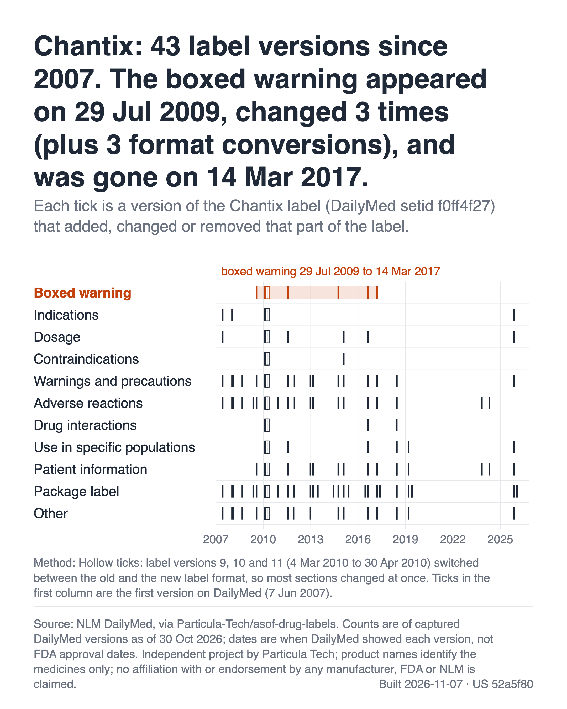
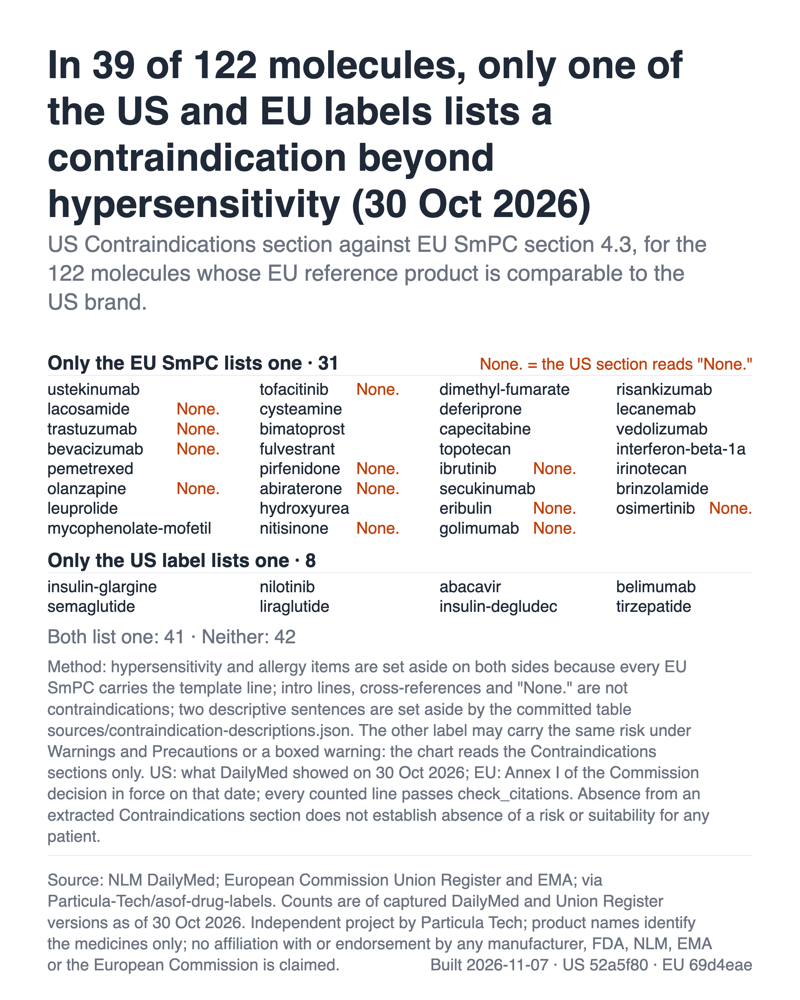

# As-of Drug Labels

What US and EU drug labels said on any date, as git history. Each published label version is one commit and each label section is one file with one sentence per line, so `git log` lists every version of a section and `git blame` credits each line to the version that wrote it. The US corpus records what DailyMed showed for the prescribing information of <!-- n:molecules -->503<!-- /n --> molecules; the EU corpus records the summary of product characteristics (SmPC) as each Commission decision put it in force. It is for regulatory affairs and pharmacovigilance research, and for engineers who want label history in an AI client through MCP. It answers three questions: which version added this sentence and when; which labels added a phrase in a date window; and where the US and EU labels of one molecule differ on a date. A read-only MCP server and a CLI answer them with citations.

## What is in it

| | US (DailyMed) | EU (Union Register) |
| --- | --- | --- |
| Molecules | <!-- n:molecules -->503<!-- /n --> selected | <!-- n:eu_products -->206<!-- /n --> with a reference product |
| Labels | <!-- n:us_labels -->5,393<!-- /n --> DailyMed setids, <!-- n:us_retired_labels -->1,411<!-- /n --> of them retired | <!-- n:eu_products -->206<!-- /n --> centrally authorised products |
| Versions (commits) | <!-- n:us_versions -->47,352<!-- /n --> label versions | <!-- n:eu_versions -->4,403<!-- /n --> Annex I versions, <!-- n:eu_corrigenda -->59<!-- /n --> of them corrigenda |
| Record | <!-- n:us_record_from -->2006-07-13<!-- /n --> to <!-- n:us_record_to -->2026-11-06<!-- /n --> | <!-- n:eu_record_from -->1996-02-14<!-- /n --> to <!-- n:eu_record_to -->2026-10-23<!-- /n --> |

DailyMed lists <!-- n:us_listed_versions -->47,793<!-- /n --> versions for these setids; <!-- n:us_fetched_pct -->99.08<!-- /n -->% are in the repo and the rest are logged with a reason in [`reports/coverage-us.json`](reports/coverage-us.json). Build date, HEAD and converter version of each corpus are in [`manifest.json`](manifest.json), from which `tools/readme_numbers.py` regenerates every number here.

## Quick start

You need git and Python 3.12 or newer (tested); the code uses the standard library only, so there is nothing to pip install. The server and the CLI make no network calls and change nothing.

```sh
git clone --recurse-submodules https://github.com/Particula-Tech/asof-drug-labels
cd asof-drug-labels
```

The corpora are the submodules `us/` and `eu/`. The clone downloads about 200 MB and takes about 850 MB on disk, mostly the US corpus. A shallow clone (`--depth`) breaks `git log` and `git blame`. If `us/` and `eu/` are empty, run `git submodule update --init --recursive` in the clone root.

### MCP server

In Claude Code, with `<path>` the clone root (the folder that contains `us/` and `eu/`):

```sh
claude mcp add asof-drug-labels -- python3 -I <path>/tools/mcp_server.py
```

Clients configured with an `mcpServers` JSON file take the same command:

```json
{ "mcpServers": { "asof-drug-labels": { "command": "python3", "args": ["-I", "<path>/tools/mcp_server.py"] } } }
```

Tools, all read-only:

- `find_label`: US labels by setid, brand, INN, NDC or RxCUI; EU products by EMA number, name, INN or holder.
- `read_label`: the text in force on a date, one section or all.
- `section_history`: every version that changed one section.
- `blame`: each line of a section on a date, credited to the version that wrote it, optionally per word.
- `diff`: word-level diff between the versions in force on two dates.
- `changes_between`: every version in a date window, optionally only where a phrase was added, removed or reworded.
- `search`: labels whose text on a date contains a phrase.
- `first_appearance`: per label, the version where a phrase appeared and where it left.
- `compare_jurisdictions`: US label and EU SmPC of one molecule on a date, aligned by topic.
- `check_citations`: whether a quote is in a version and section, and whether that version was in force on a date.
- `coverage`: scope, record window and build date of each corpus.

### CLI

Run from the clone root; each command prints what the matching MCP tool returns:

<pre><code># 1. Which version added this sentence to Warnings and Precautions, credited word by word
python3 -I tools/cli.py blame <!-- n:q1_as_of -->2026-10-30<!-- /n --> 1e11ad30-1041-4520-10b0-8f9d30d30fcc --section 43685-7 --words

# 2. Every US label that added "suicidal ideation" to Warnings and Precautions in 2023-2025
python3 -I tools/cli.py changes 2023-01-01 2025-12-31 --section 43685-7 --query "suicidal ideation"

# 3. What the EU Avastin SmPC lists as a contraindication that the US Avastin label does not
python3 -I tools/cli.py compare <!-- n:q3_molecule -->bevacizumab<!-- /n --> <!-- n:q3_date -->2026-10-30<!-- /n --> --section <!-- n:q3_section -->contraindications<!-- /n -->
</code></pre>

On this build ([`visualisations/data/01-example-queries.json`](visualisations/data/01-example-queries.json)):

1. The Synthroid sentence "Consider the potential for food or drug interactions and adjust the administration or dosage of SYNTHROID as needed" is credited to label version <!-- n:q1_version -->1533<!-- /n -->, which DailyMed showed from <!-- n:q1_date -->2022-09-26<!-- /n -->.
2. <!-- n:q2_added -->4<!-- /n --> labels added the phrase, all hydroxychloroquine, first Plaquenil version <!-- n:q2_first_version -->12<!-- /n --> on <!-- n:q2_first_date -->2023-08-02<!-- /n -->; <!-- n:q2_removed -->3<!-- /n --> removed it and <!-- n:q2_reworded -->14<!-- /n --> reworded it.
3. On <!-- n:q3_date -->2026-10-30<!-- /n --> US Contraindications (version <!-- n:q3_us_version -->39<!-- /n -->) reads only "None."; EU section 4.3 has <!-- n:q3_only_eu -->3<!-- /n --> lines the US lacks (hypersensitivity to the active substance, hypersensitivity to CHO cell products, pregnancy), from Annex I of Commission decision <!-- n:q3_eu_decision -->(2025) 9182<!-- /n --> of <!-- n:q3_eu_decision_date -->2025-12-18<!-- /n -->.

### Plain git

```sh
git -C us log --oneline -- varenicline/f0ff4f27-5185-4881-a749-c6b7a0ca5696/34066-1-boxed-warning.md
git -C us blame -- levothyroxine/1e11ad30-1041-4520-10b0-8f9d30d30fcc/43685-7-warnings-and-precautions.md
```

The first lists every version of the Chantix boxed warning; the file is not at HEAD, because the warning left the label on <!-- n:life_boxed_removed -->2017-03-14<!-- /n -->, but `git log` on the path still works. The second credits each line of the Synthroid Warnings and Precautions section.

## Charts



<!-- n:title_life -->Chantix: 43 label versions since 2007. The boxed warning appeared on 29 Jul 2009, changed 3 times (plus 3 format conversions), and was gone on 14 Mar 2017.<!-- /n -->



<!-- n:title_us_vs_eu -->In 39 of 122 molecules, only one of the US and EU labels lists a contraindication beyond hypersensitivity (30 Oct 2026)<!-- /n -->

The second chart records presence, not wording. How it counts, and the other charts, are in [`visualisations/README.md`](visualisations/README.md).

## How dates work

- **US:** "on date X" is the newest version whose `Published-Date` is on or before X: what DailyMed showed that day. It is not the FDA approval date. A version can reach DailyMed before or after the FDA action it reflects, and DailyMed says its labels are submitted by companies and may differ from the FDA-approved text.
- **EU:** "on date X" is the newest Annex I whose Commission decision date (`Effective-Date`) is on or before X, cited as "the Union Register carries this text as Annex I of Commission decision (number) of (date)". The decision date is not the Official Journal date. A corrected annex counts from the date of the decision it corrects.
- **Record end:** each corpus ends at its newest Published-Date or decision date (`record_to` in `manifest.json`), and every MCP answer repeats it with the build date. Later versions may exist on DailyMed or in the Union Register.

## What it does not show

- Not every drug: <!-- n:molecules -->503<!-- /n --> molecules, at most <!-- n:cap_nda_bla -->10<!-- /n --> NDA/BLA and <!-- n:cap_generic -->6<!-- /n --> generic labels each, no repackagers or relabelers. A product whose labeler changed setid appears as several labels; `molecules/*.json` lists every setid.
- Not every version: <!-- n:us_logged_versions -->441<!-- /n --> versions DailyMed lists are missing (<!-- n:us_logged_no_file -->437<!-- /n --> with no archived file, <!-- n:us_logged_corrupt -->4<!-- /n --> corrupt). The record is thin before 2009.
- Not everything in a label: images, SPL product data and Highlights excerpts are dropped; old-format WARNINGS and PRECAUTIONS are filed together as Warnings and Precautions; uncoded sections go under `42229-5`. A conversion artefact, such as a switch to the PLR format, shows in `git diff` like a label change.
- EU: <!-- n:eu_no_reference -->297<!-- /n --> molecules have no EU reference product (<!-- n:eu_no_central -->261<!-- /n --> have no centrally authorised product, <!-- n:eu_only_combination -->27<!-- /n --> only combination products, which are not included). One product per molecule, English Annex I only: no Annex II, Annex III, package leaflet or nationally authorised products.
- `compare_jurisdictions` compares normalised lines, so a reworded sentence counts as different.
- Material removed on request (<!-- n:removed_total -->0<!-- /n --> so far) is listed in [`sources/removed.json`](sources/removed.json).

## Validation against FDA safety labeling changes

FDA's Safety-related Labeling Changes database (SrLC) lists the text each safety labeling change added and its approval date. We checked whether the repo shows that text arriving on DailyMed near that date.

**Result: for <!-- n:srlc_matches -->37<!-- /n --> of <!-- n:srlc_items -->50<!-- /n --> sampled SrLC changes (<!-- n:srlc_rate_pct -->74<!-- /n -->%), DailyMed showed the added text appearing within <!-- n:srlc_window_days -->183<!-- /n --> days of the FDA approval date.**

The population, sample rule and window were fixed in [`sources/srlc-sample.json`](sources/srlc-sample.json) before any matching: of <!-- n:srlc_population_sections -->10,952<!-- /n --> SrLC items from <!-- n:srlc_first_year -->2016<!-- /n --> to <!-- n:srlc_last_year -->2025<!-- /n --> in six safety sections for applications in this corpus, <!-- n:srlc_eligible -->6,271<!-- /n --> were eligible, and five per year were taken in the order of a fixed hash. Matches appeared a median of <!-- n:srlc_median_lag -->11<!-- /n --> days after approval. [`reports/srlc-validation.md`](reports/srlc-validation.md) explains each of the <!-- n:srlc_misses -->13<!-- /n --> misses and gives the sensitivity checks and the one revision made after results were seen. A match shows that DailyMed carried the text near the approval date. It does not show that the label in the repo was FDA-approved on any particular date. The run used the corpus of <!-- n:srlc_generated -->2026-11-01<!-- /n -->.

Known readings checked against DailyMed's version pages and the annex PDFs run as tests ([`tools/tests/known_readings.json`](tools/tests/known_readings.json), [`tools/tests/eu_known_readings.json`](tools/tests/eu_known_readings.json)). `compare_jurisdictions` returns cited text for <!-- n:compare_works -->199<!-- /n --> of <!-- n:compare_molecules -->206<!-- /n --> molecules with <!-- n:compare_citation_failures -->0<!-- /n --> citation failures ([`reports/compare-check.md`](reports/compare-check.md)).

## Daily updates

A GitHub Action ([`.github/workflows/daily-update.yml`](.github/workflows/daily-update.yml)) appends new DailyMed versions and Commission decisions as new commits, without changing any existing hash, and tags both corpora `daily/YYYY-MM-DD`. Details are in [`docs/daily-update.md`](docs/daily-update.md).

## Layout

A US label is a folder `<inn>/<setid>/` with `label.json` and one file per LOINC section (`43685-7-warnings-and-precautions.md`); an EU product is `<inn>/<EMEA-H-C-number>/` with `product.json` and one file per SmPC section (`smpc-4.3-contraindications.md`). Text is one sentence per line. Commit trailers: `Source-Id`, `Source-Version`, `Published-Date` or `Effective-Date`, `Source-URL`, `Source-SHA256`, `Text-Fidelity`. The EU format is in [`docs/eu-format.md`](docs/eu-format.md).

## Reproduce

Raw files are pinned by URL and SHA-256 in `sources/`, and `tools/build.py` and `tools/eu.py` rebuild both corpora hash for hash; see [`reproduce.md`](reproduce.md).

## Sources and licences

- **US:** Courtesy of the U.S. National Library of Medicine ([DailyMed](https://dailymed.nlm.nih.gov/dailymed/)); NLM does not endorse this project. This record may not reflect the most current or accurate data available from NLM. Label text is reproduced under the [NLM Terms and Conditions](https://www.nlm.nih.gov/databases/download/terms_and_conditions.html), with copyright staying with its holders; it is not public domain, CC0 or openly licensed.
- **EU:** © European Union, 1995-2026. English Annex I of Commission decisions from the Union Register of medicinal products, with metadata from the European Medicines Agency, reused under Commission Decision 2011/833/EU and [CC BY 4.0](https://creativecommons.org/licenses/by/4.0/). Changes: converted from PDF to Markdown and split into QRD sections; wording intended to be unchanged. The Commission and EMA do not endorse this project.
- **Code:** [Apache-2.0](LICENSE) with [`NOTICE`](NOTICE); it does not cover label text, in which Particula Tech claims no copyright. Each corpus states its terms in its `NOTICE.md` ([US](https://github.com/Particula-Tech/asof-drug-labels-us/blob/HEAD/NOTICE.md), [EU](https://github.com/Particula-Tech/asof-drug-labels-eu/blob/HEAD/NOTICE.md)).
- **Fidelity:** automated conversion can introduce errors; the pinned source file each version cites is authoritative, and where this copy differs from the official DailyMed document or Annex I PDF, the official text prevails.
- **Contact:** rights holders, people named in label text, and anyone who finds a conversion error can email legal@particula.tech with the product, setid or file path. We acknowledge within 5 business days and, for a valid request, remove the material from the current tree within 10 business days and from the published history at the next rebuild. Conversion errors can also be filed with the [Correction template](https://github.com/Particula-Tech/asof-drug-labels/issues/new?template=correction.yml).

Not medical, legal or regulatory advice; warranty, independence, trade marks and personal data are covered in [`disclaimer.md`](disclaimer.md).

## Glossary

| Term | Meaning |
| --- | --- |
| setid | DailyMed's identifier for one label across its versions |
| LOINC code | The code of an SPL section, such as `43685-7` Warnings and Precautions |
| PLR | Physician Labeling Rule: the US format with Highlights and numbered sections |
| SmPC | Summary of product characteristics: Annex I of an EU authorisation decision |
| QRD | EMA's template that fixes SmPC section numbers (4.3 is Contraindications) |
| INN | International Nonproprietary Name, the generic name; also the folder name |

---

## Particula Tech

Built by [Particula Tech](https://particula.tech), an independent engineering company. [See what we would build on this for your team](https://particula.tech/open-source/asof?utm_source=github&utm_medium=readme&utm_campaign=asof-drug-labels).
